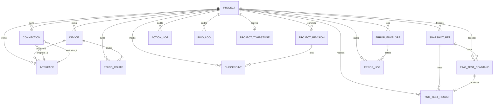

# Entity Relationship Diagram — TASK-06

## Cardinality notes

- `project.project_id` is UUIDv7 and the aggregate root.
- `device.device_id`, `interface.interface_id`, `connection.connection_id`,
  `static_route.route_id`, `checkpoint.checkpoint_id`, `snapshot_ref.snapshot_id`,
  `ping_test_command.test_id`, `ping_test_result.test_id`, `error_envelope.error_id`,
  `action_log.log_id`, `ping_log.log_id`, `error_log.log_id` are all UUIDv7.
- `project_revision` is composite-keyed by `(project_id, revision)`.
- `checkpoint` carries a composite FK to `(project_id, revision)`.
- `ping_test_result` carries composite FKs to `(project_id, test_id)` via the
  command and to `(project_id, snapshot_id)` via the snapshot.
- `ping_log` carries composite FKs to the command and snapshot.
- `error_envelope.snapshot_id` is validated by trigger rather than FK, so that
  project-less errors remain representable.
- `project_tombstone.project_id` is a plain primary key with no FK; it survives
  the project purge.
